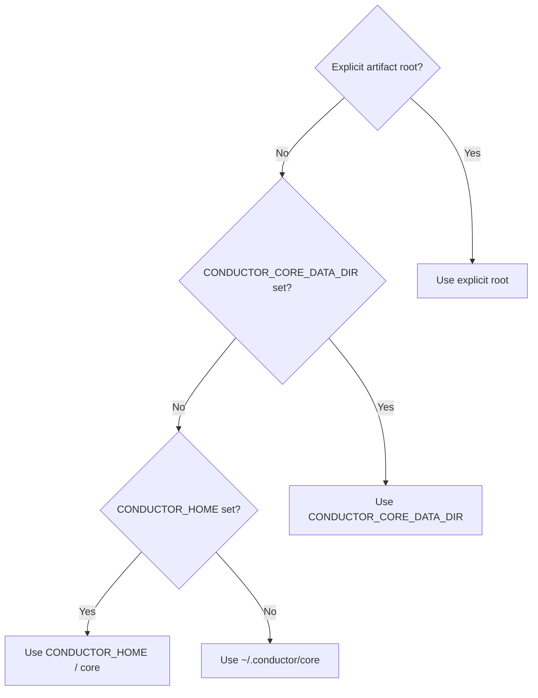

# Artifacts and audio

## Data directory

Core stores durable history under one predictable Conductor suite root:

```text
~/.conductor/
  core/
    generations/
      gen_<id>/
        loop.mid
        loop.mp3          # only when audio rendering succeeds; a re-render
                          # saves loop-<timestamp>.mp3 instead
        messages.json     # when provider messages are available
        metadata.json     # artifact paths stored as relative file names
      variations/
        batch_<id>.json  # shared request metadata and generation IDs
```

On Windows, the default is `%USERPROFILE%\.conductor\core`. Selection follows
this precedence:

1. `CONDUCTOR_CORE_DATA_DIR` selects Core's complete project data directory.
2. `CONDUCTOR_HOME` selects the shared suite root; Core appends `core`.
3. Core uses `Path.home() / ".conductor" / "core"`.

Both environment variables support `~` expansion.



```powershell
$env:CONDUCTOR_HOME = "D:\ConductorData"
$env:CONDUCTOR_CORE_DATA_DIR = "D:\ConductorData\custom-core"
```

An explicit `EngineConfig.artifact_root` or `FilesystemArtifactStore` root
overrides the default. Resolving or importing paths does not create directories;
Core creates the history directory only when writing a generation workspace.
Packaged prompts, metadata, and the bundled SoundFont remain read-only package
resources.

## Retention

Core keeps every generation by default (`max_generations=None`). MIDI, JSON,
and especially MP3 files accumulate, so applications that do not manage disk
use themselves should set a limit on the engine or store.

```python
from conductor_core import EngineConfig
from conductor_core.storage import FilesystemArtifactStore

config = EngineConfig.from_defaults(max_generations=100)
capped_store = FilesystemArtifactStore("my-output", max_generations=20)
```

The limit counts saved generations, not provider requests or disk bytes. Each
variation in a batch counts separately, so a request for four variations needs
`max_generations >= 4` or `None` for unlimited retention. Core rejects a batch
that exceeds the actual store's finite limit before provider work begins.
The generation being finalized takes priority during its retention pass, along
with any protected variation batch. Core fills remaining capacity with the newest
prior history, even if a clock change makes older work appear newer than the
current generation. Future-dated records follow the same timestamp ordering.
Later requests can prune artifacts from previously returned generations or
batches. Variation manifests have a separate
lifetime and are not removed by generation retention; see
[Variation history](variations.md#variation-history).

## Generation results

| Attribute | Contents |
| --- | --- |
| `generation_id` | Unique filesystem generation identifier. |
| `loop` | Validated provider-independent loop object. |
| `midi_path` | Absolute path to the persisted MIDI. |
| `audio_path` | Absolute path to the persisted MP3 when rendering succeeds. |
| `messages` | Provider conversation messages, each a dict with a `role` (`system`, `user`, or `assistant`) and string `content`. |
| `cost` | Provider-reported estimated cost when available. |
| `metadata` | Persisted generation metadata. On disk, its artifact paths are file names relative to the generation directory; Core rebinds them to absolute paths on load. |
| `warnings` | Non-fatal issues such as skipped audio. |

Use `FilesystemArtifactStore` for custom roots, loading or deleting saved
generations, and updating saved audio metadata.

### Timestamps

`GenerationMetadata.timestamp` is a timezone-aware UTC datetime. New metadata
records the finalization time in UTC, and timestamp-based generation IDs use UTC
when the workspace is allocated. IDs keep the `YYYYMMDD_HHMMSS_ffffff` format.

When reading stored metadata, Core converts timestamps to UTC in memory. Values
without timezone information are interpreted using the reading machine's local
timezone; their original timezone cannot be recovered from the file. Reads leave
metadata files unchanged. History and retention order records by their timestamp
instant. Compare returned timestamps with other timezone-aware datetimes.

## Audio previews

Set `render_audio=True` to render an MP3 after MIDI generation. Place FluidSynth
and FFmpeg with MP3 encoding support on `PATH`.
Core invokes FluidSynth to synthesize WAV audio, then FFmpeg directly to trim and
encode it as a 192 kbps MP3. FluidSynth has a 3-second timeout and FFmpeg a
2-second timeout. With no
`soundfont_path`, Core uses its packaged SoundFont; set the request path or
`EngineConfig.default_soundfont_path` to choose another.

Audio failure does not discard successful MIDI generation. Core returns a
warning and `audio_path=None`. Lower-level discovery and rendering helpers live
in `conductor_core.playback`. Rendered audio is trimmed to the MIDI endpoint;
SoundFont release tails are intentionally excluded so the preview duration
matches the loop boundary.

### Replacing saved audio safely

Use the store already attached to your engine, or import the default-root helper
from `conductor_core.storage`. Available signatures are:

```python
FilesystemArtifactStore.stage_generation_audio(gen_id: str) -> GenerationAudioStage
stage_generation_audio(gen_id: str) -> GenerationAudioStage
GenerationAudioStage.commit(*, soundfont: str | None) -> GenerationMetadata
```

`GenerationAudioStage.path` is a string render destination available inside its
context. Render there instead of over the saved MP3. Each commit saves the audio
under a new UTC timestamp name, such as `loop-20261120_153012_123456.mp3`, so
apps that serve generation folders directly get a new URL for every re-render
and browsers do not replay cached audio. Always read the current file from the
returned `audio_path`; generations that were never re-rendered keep `loop.mp3`.
Core records
`soundfont` by file name, so passing a full path keeps the directory out of
`metadata.json`:

```python
from conductor_core import AudioCommitRecoveryError
from conductor_core.playback import midi_to_mp3

try:
    with engine.store.stage_generation_audio(generation_id) as stage:
        midi_to_mp3(
            midi_path,
            output_path=stage.path,
            soundfont_name=selected_soundfont,
        )
        updated = stage.commit(soundfont=selected_soundfont)
except AudioCommitRecoveryError as exc:
    # The saved audio and metadata are unchanged; keep the previous UI state.
    # exc.commit_error and exc.rollback_error describe both failures.
    # exc.rollback_error.filename names the unreferenced new MP3; the next
    # successful commit removes it. exc.recovery_directory is safe to delete.
    raise
else:
    # Publish UI state only after both saved files have been promoted.
    current_audio_path = updated.audio_path
    current_soundfont = updated.soundfont
```

Core owns the stage directory inside the generation directory, its staged MP3,
and prepared metadata. It validates the generation on entry and again at commit.
Before promotion, it prepares metadata. It moves the staged MP3 to its new name
beside the saved files, then replaces metadata. The previous MP3 is untouched
until the metadata replacement succeeds; Core then deletes every other Core
audio file in the generation directory, including leftovers from earlier
commits. If a delete fails, such as for a file a player holds open, Core logs a
warning, keeps that file for the next commit to retry, and the commit still
succeeds. On a caught metadata promotion `OSError`, Core removes the new MP3,
the original error propagates, and the caller can retain its previous UI state.
Preparation and audio promotion failures leave the saved pair unchanged.

If removing the new MP3 also raises `OSError`, `AudioCommitRecoveryError` (an
`OSError` subclass) exposes `commit_error`, `rollback_error`, and
`recovery_directory`. Its message includes both failures and its cause is the
original commit error. The saved audio and metadata are still unchanged.
`rollback_error.filename` names the unreferenced new MP3 left in the generation
directory; the next successful commit removes it, and deleting the generation
removes it too. `recovery_directory` is the retained stage directory, holding
only the prepared metadata that was never promoted. It is safe to delete.

When loading, metadata decides which audio file a generation has. Core follows
the name in `audio_path`; `null` means no audio, even if a stray `loop.mp3` is on
disk. A name Core does not write, such as a hand-edited `song.mp3`, is logged
and ignored, so the generation loads without audio.

Context exit cleans up after success, abandonment, or confirmed rollback. Cleanup
errors are logged and never change a successful result or mask the original
failure. Recovery-required contexts preserve their directory. A stage is
single-use, cannot be re-entered, and allows only one commit attempt. Missing
generations raise `FileNotFoundError`; invalid metadata and artifact validation
errors propagate. Missing or empty staged audio fails before promotion.

Audio stages share a process-wide reservation keyed by canonical
root and generation ID, including across separate store instances and the
module-level helper. The reservation lasts for the entire context, including
rendering. Overlapping updates raise `AudioUpdateInProgressError` immediately.
Import it from `conductor_core`; it subclasses `RuntimeError`, so callers
can distinguish a busy generation from stage misuse. This does not
coordinate other processes, direct file writes, generation deletion, or retention;
consumers must prevent those operations from racing an audio update. The guarantee
covers caught filesystem errors, not process crashes or atomic visibility across
two files. A reader holding metadata from before a commit can briefly find its
audio file already deleted.

## Direct MIDI utilities

Consumers can convert existing MIDI to Core's four-bar loop model and write it
back without calling a provider. See
[`scripts/midi_loop_roundtrip.py`](https://github.com/laceyp99/conductor-core/blob/main/scripts/midi_loop_roundtrip.py)
for an
offline example that normalizes note starts and durations to sixteenth-note
integer positions.

MIDI import and audio rendering support formats 0 and 1. Format 2 stores
independent patterns without a shared timeline, so `midi_to_loop()` rejects it
with `ValueError` and `midi_to_mp3()` reports `AudioRenderingError`. Extract the
desired pattern into a format 0 or 1 file before using these utilities.

MIDI export uses channel 0 and treats overlapping notes of the same MIDI pitch
as retriggers: the earlier note ends when the next note starts, including across
bar boundaries. Notes that touch without overlapping are unchanged. Simultaneous
notes of the same pitch keep the highest velocity, then the longest duration;
exact duplicates become one MIDI note. Different pitches remain independent.

`loop_to_midi()` returns one summary warning when this cleanup shortens or
consolidates notes, with separate counts for each change. The engine includes it
in the result's `warnings`. The source `Loop` and provider message history are
unchanged. Original generated timings remain in `messages.json` for normal
generations and in the shared batch message history for variations. No additional
Loop artifact is written. Direct utility callers must save their own source data
if they need it later; importing the MIDI alone recovers the cleaned playback
timings, not the original overlaps.

Related modules include:

- `conductor_core.models` for loop, bar, note, and timing models;
- `conductor_core.music` for model metadata, prompts, scales, and durations;
- `conductor_core.routing` for lower-level routing, where `generate_midi()`
  returns a `LoopProviderResult` with `loop`, `messages`, `cost`, and
  `provider` fields;
- `conductor_core.storage` for artifacts and history; and
- `conductor_core.playback` for optional audio operations.

Prefer `LoopGenerationEngine` for complete generation workflows so persistence,
cleanup, prompt handling, and provider behavior remain consistent.
