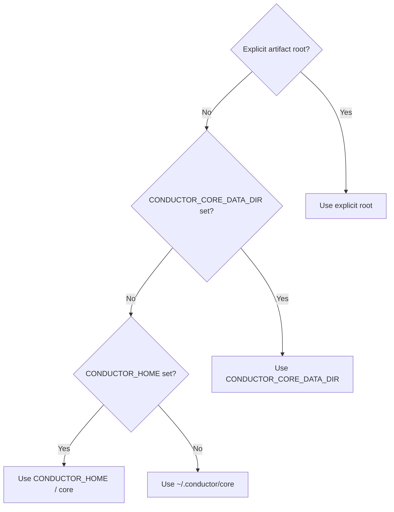

# Artifacts and audio

## Data directory

Core stores durable history under one predictable Conductor suite root:

```text
~/.conductor/
  core/
    generations/
      gen_<id>/
        loop.mid
        loop.mp3          # only when audio rendering succeeds
        messages.json     # when provider messages are available
        metadata.json
      variations/
        batch_<id>.json  # shared request metadata and generation IDs
```

On Windows, the default is `%USERPROFILE%\.conductor\core`. Selection follows
this precedence:

1. `CONDUCTOR_CORE_DATA_DIR` selects Core's complete project data directory.
2. `CONDUCTOR_HOME` selects the shared suite root; Core appends `core`.
3. Core uses `Path.home() / ".conductor" / "core"`.

Both environment variables support `~` expansion.



```powershell
$env:CONDUCTOR_HOME = "D:\ConductorData"
$env:CONDUCTOR_CORE_DATA_DIR = "D:\ConductorData\custom-core"
```

An explicit `EngineConfig.artifact_root` or `FilesystemArtifactStore` root
overrides the default. Resolving or importing paths does not create directories;
Core creates the history directory only when writing a generation workspace.
Packaged prompts, metadata, and the bundled SoundFont remain read-only package
resources.

## Retention

Core retains the newest 20 generations by default. MIDI, JSON, and especially
MP3 files can still consume substantial space. Configure retention on the
engine or store; use `None` only when the calling application owns disk policy.

```python
from conductor_core import EngineConfig
from conductor_core.storage import FilesystemArtifactStore

config = EngineConfig.from_defaults(max_generations=100)
unlimited_store = FilesystemArtifactStore("my-output", max_generations=None)
```

The limit counts saved generations, not provider requests or disk bytes. Each
variation in a batch counts separately, so a request for four variations needs
`max_generations >= 4` or `None` for unlimited retention. Core rejects a batch
that exceeds the actual store's finite limit before provider work begins.
The generation being finalized takes priority during its retention pass, along
with any protected variation batch. Core fills remaining capacity with the newest
prior history, even if a clock change makes older work appear newer than the
current generation. Future-dated records follow the same timestamp ordering.
Later requests can prune artifacts from previously returned generations or
batches. Variation manifests have a separate
lifetime and are not removed by generation retention; see
[Variation history](variations.md#variation-history).

## Generation results

| Attribute | Contents |
| --- | --- |
| `generation_id` | Unique filesystem generation identifier. |
| `loop` | Validated provider-independent loop object. |
| `midi_path` | Persisted MIDI path. |
| `audio_path` | Persisted MP3 path when rendering succeeds. |
| `messages` | Provider conversation messages, each a dict with a `role` (`system`, `user`, or `assistant`) and string `content`. |
| `cost` | Provider-reported estimated cost when available. |
| `metadata` | Persisted generation metadata. |
| `warnings` | Non-fatal issues such as skipped audio. |

Use `FilesystemArtifactStore` for custom roots, loading or deleting saved
generations, and updating saved audio metadata.

### Timestamps

`GenerationMetadata.timestamp` is a timezone-aware UTC datetime. New metadata
records the finalization time in UTC, and timestamp-based generation IDs use UTC
when the workspace is allocated. IDs keep the `YYYYMMDD_HHMMSS_ffffff` format.

When reading stored metadata, Core converts timestamps to UTC in memory. Values
without timezone information are interpreted using the reading machine's local
timezone; their original timezone cannot be recovered from the file. Reads leave
metadata files unchanged. History and retention order records by their timestamp
instant. Compare returned timestamps with other timezone-aware datetimes.

## Audio previews

Set `render_audio=True` to render an MP3 after MIDI generation. Place FluidSynth
and FFmpeg with MP3 encoding support on `PATH`.
Core invokes FluidSynth to synthesize WAV audio, then FFmpeg directly to trim and
encode it as a 192 kbps MP3. Each process has a 5-second timeout. With no
`soundfont_path`, Core uses its packaged SoundFont; set the request path or
`EngineConfig.default_soundfont_path` to choose another.

Audio failure does not discard successful MIDI generation. Core returns a
warning and `audio_path=None`. Lower-level discovery and rendering helpers live
in `conductor_core.playback`. Rendered audio is trimmed to the MIDI endpoint;
SoundFont release tails are intentionally excluded so the preview duration
matches the loop boundary.

## Direct MIDI utilities

Consumers can convert existing MIDI to Core's four-bar loop model and write it
back without calling a provider. See
[`scripts/midi_loop_roundtrip.py`](https://github.com/laceyp99/conductor-core/blob/main/scripts/midi_loop_roundtrip.py)
for an
offline example that normalizes note starts and durations to sixteenth-note
integer positions.

MIDI import and audio rendering support formats 0 and 1. Format 2 stores
independent patterns without a shared timeline, so `midi_to_loop()` rejects it
with `ValueError` and `midi_to_mp3()` reports `AudioRenderingError`. Extract the
desired pattern into a format 0 or 1 file before using these utilities.

MIDI export uses channel 0 and treats overlapping notes of the same MIDI pitch
as retriggers: the earlier note ends when the next note starts, including across
bar boundaries. Notes that touch without overlapping are unchanged. Simultaneous
notes of the same pitch keep the highest velocity, then the longest duration;
exact duplicates become one MIDI note. Different pitches remain independent.

`loop_to_midi()` returns one summary warning when this cleanup shortens or
consolidates notes, with separate counts for each change. The engine includes it
in the result's `warnings`. The source `Loop` and provider message history are
unchanged. Original generated timings remain in `messages.json` for normal
generations and in the shared batch message history for variations. No additional
Loop artifact is written. Direct utility callers must save their own source data
if they need it later; importing the MIDI alone recovers the cleaned playback
timings, not the original overlaps.

Related modules include:

- `conductor_core.models` for loop, bar, note, and timing models;
- `conductor_core.music` for model metadata, prompts, scales, and durations;
- `conductor_core.routing` for lower-level routing, where `generate_midi()`
  returns a `LoopProviderResult` with `loop`, `messages`, `cost`, and
  `provider` fields;
- `conductor_core.storage` for artifacts and history; and
- `conductor_core.playback` for optional audio operations.

Prefer `LoopGenerationEngine` for complete generation workflows so persistence,
cleanup, prompt handling, and provider behavior remain consistent.
